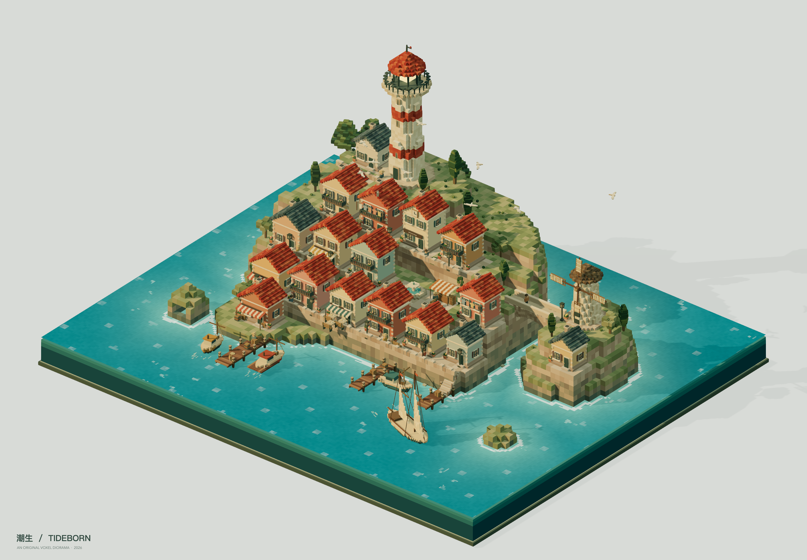

# 潮生 / TIDEBORN

创作模型：**GPT-6.1 sol**。

一座想象中的地中海灯塔港城。19,385 个独立方块构筑四层街区、灯塔、拱桥、风车与渔港；4 艘船轻轻起伏，11 位居民沿街散步，海鸥从屋顶上空飞过。

[进入在线作品](https://thysummer14.github.io/voxel-atelier/chaosheng/)



可以切换晨光、日落与入夜，使用五个预设镜头或自由旋转、缩放、平移。光点可展开地标故事，海风音景需要主动点击开启。右上角可以保存 3200 像素宽的 PNG。

`index.html` 是代码、样式、图标和模型全部内嵌的交互版。静态服务和 GitHub Pages 均可直接提供该文件，不需要构建服务器；下载后也可以用支持 WebGL 2 的浏览器打开。

## 文件

- [MagicaVoxel 模型](models/潮生-TIDEBORN.vox)：749,430 个体素，239 × 199 × 124，255 色。
- [夜景高清图](renders/02-night.png)。
- [验证记录](reports/验证记录.md)：34 项浏览器交互检查、资源隔离验证、模型完整性与性能记录。
- [可编辑源码](source/)：固定 seed，可复现，未使用现成三维模型。

## 继续开发

```sh
cd source
npm ci
npm run dev
```

```sh
npm run export:vox
npm run check
npm run package:artwork
```

打包产物是 `source/output/潮生-TIDEBORN.html`。更新展厅版本时，将其复制到本目录的 `index.html`。交互、音景、导出实现和完整开发说明见 [source/README.md](source/README.md)。

VOX 保存静态体素；动态、海水、招牌文字与光照效果在交互版中体验。Three.js 的 MIT 许可保留在页面内与 `source/public/THIRD_PARTY_NOTICES.txt` 中。
