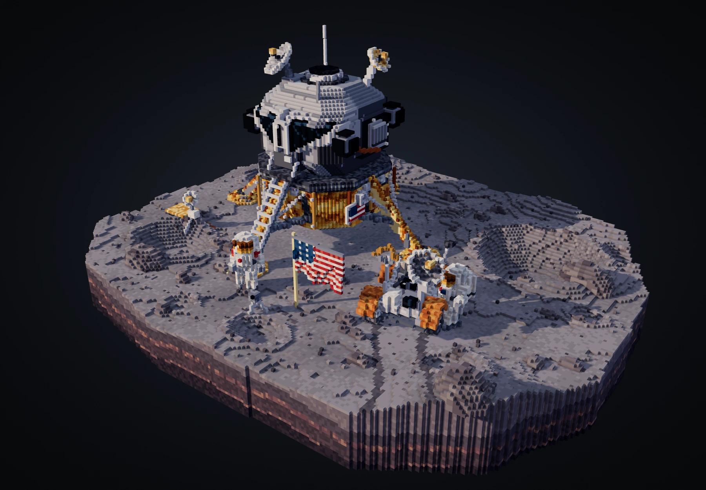

# 月面余光 · LAST LIGHT

**体素创作 · gpt-6.2 sol 灰测**

阿波罗 17 号「挑战者」登月舱立在月壤剖面上。金箔沿下降级折叠，左右两扇三角舷窗探出舱体。扶梯底部有靴印，月球车旁留下两道车辙。可以从展柜上方绕行，也可以降到月面，从山谷里回望着陆点。

[打开交互展页](https://thysummer14.github.io/voxel-atelier/last-light/) · [下载可编辑体素模型](./last-light.vox) · [月面留影](./renders/surface.webp)

## 实物参考

作品独立建模，实物依据来自 NASA 任务影像。登月舱的两级结构、着陆支腿、隔热层、月球车和舱外服来自实拍观察。地形剖面、地球大小、人物位置及着陆点陈设为取景做过艺术调整。

- [AS17-134-20382 · 舱体、旗帜和宇航员](https://www.nasa.gov/image-detail/amf-as17-134-20382/)
- [AS17-146-22296 · 月球车与宇航员](https://www.nasa.gov/image-detail/amf-as17-146-22296/)
- [NASA Scientific Visualization Studio · 着陆区和月谷](https://svs.gsfc.nasa.gov/4302/)
- [NASA Science · 月球车天线与地球](https://science.nasa.gov/resource/view-of-earth-above-the-antenna-of-the-lunar-roving-vehicle-during-eva/)

## 浏览与复现

从仓库根目录运行 `python3 -m http.server 8899`，打开 `http://localhost:8899/last-light/`。展页从本地模块加载，不需要 npm 安装或 CDN。支持拖动、滚轮、触控捏合及全屏。聚焦展品后，可用方向键旋转、加减键缩放、Home 键复位。

`src/world.mjs` 组装整数格点模型。`src/terrain.mjs` 生成撞击坑和横剖面，`src/lander.mjs` 与 `src/expedition.mjs` 搭建登月舱、月球车及人员装备。`src/mesh.mjs` 提取露出的六向体素表面并逐顶点计算遮蔽。`src/horizon.mjs` 为月面镜头生成远山和地球。

在本目录运行 `node tools/export-vox.mjs` 可重建 `last-light.vox`，加 `--check` 可核对文件。当前模型为 727,622 个非空格点，导出边界为 210 × 162 × 99。VOX 文件包含展柜中的实物与月壤切片，月面镜头独有的远山、地球和灯光由展页生成。

静态留影来自同一渲染器。开发预览运行时，可用 Playwright CLI 的 `run-code --filename=last-light/tools/capture.js` 重拍 PNG。

浏览器渲染使用 [Three.js r170](https://github.com/mrdoob/three.js/tree/r170)，MIT 许可证见 [THREE-LICENSE.txt](./vendor/THREE-LICENSE.txt)。
