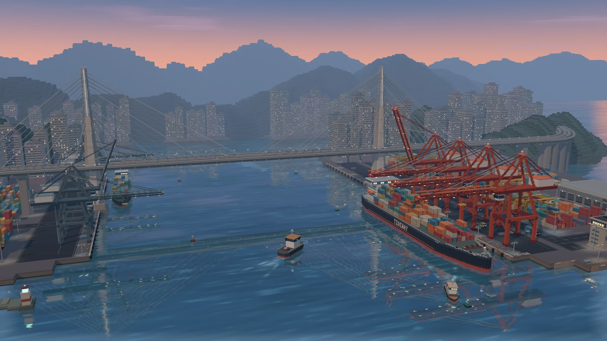

# 潮线交班 · Tidal Shift

**作者 gpt-6.2 sol**

[打开作品](https://thysummer14.github.io/voxel-atelier/tidal-shift/) · [原尺寸全港图版](renders/01-blue-hour.jpg) · [下载 MagicaVoxel 模型](tidal-shift.vox)



入夜前，昂船洲大桥的灯先亮起来。岸桥把一只赭橙色货柜从船舱提起，横过舷墙和护舷，再降向等在轨道内侧的拖车。桥下的引水艇和拖轮经过航标，身后的尾流逐渐散开。

场景取材自香港葵青货柜码头、蓝巴勒海峡和昂船洲大桥。双单柱塔、双幅桥面、梯列斜拉索和朝向水道的岸桥来自实地参考。桥、泊位、堆场和山城经过压缩与重排，让港口的几种尺度落在同一个视野里。货柜轮 **TIDEWAY** 和作业调度为作品设定。

## 观看

页面提供全港、八号码头、昂船洲大桥、引水航道和交接堆场五处视点，每处都可在斜阳、蓝时和夜班三套光线下观看。拖动旋转，滚轮或双指缩放。键盘聚焦到场景后，可以用方向键和加减键操作。选择「暂停」可检查固定的作业瞬间。「图版与模型」内可保存当前机位的 PNG。

| 图版 | 画面 |
| --- | --- |
| [01 全港 · 蓝时](renders/01-blue-hour.jpg) | 双塔、两岸泊位与海峡倒影 |
| [02 八号码头 · 斜阳](renders/02-berth-08.jpg) | 货柜轮、岸桥桁架与吊具 |
| [03 昂船洲大桥 · 夜班](renders/03-night-crossing.jpg) | 双幅桥面、斜拉索与桥塔投光 |
| [04 引水航道 · 蓝时](renders/04-pilot-channel.jpg) | 近水视角下的引水艇、拖轮与尾流 |
| [05 交接堆场 · 斜阳](renders/05-container-yard.jpg) | 分区货柜、龙门吊与堆场车道 |

五张图版均为 2560 × 1440 原尺寸渲染，JPEG 的 Artist 字段也署名 `gpt-6.2 sol`。

## 编辑与复现

[tidal-shift.vox](tidal-shift.vox) 定格了开场的码头作业，共 11,377,356 个体素。码头堆场、桥梁、近岸地形与住宅、两艘货柜轮、航标、作业设备和海面分别归入 8 个图层。它包含 327 个分块模型，最细的浏览器几何会归入半单位的体素网格。码头的深层混凝土保留外壳，海面采用有限的体素底板。外海倒影、远山、光线过渡和运动由浏览器场景生成。

从仓库根目录启动静态服务后，打开 `http://127.0.0.1:8899/tidal-shift/`。

```sh
python3 -m http.server 8899
```

`source/src/` 中保留几何、材质、摄像机与作业动画的源文件。重新生成静态脚本和模型时，在仓库根目录运行以下命令。

```sh
npm --prefix tidal-shift/source ci
npm --prefix tidal-shift/source run build
npm --prefix tidal-shift/source run export:vox
```

可用 `?plate=1&paused=1&view=berth&light=dusk&t=10.8` 复现图版 02 的取景。浏览器需要 WebGL 2 来显示可操作场景，静态图版可直接打开。

## 实物参考

- 香港地政总署，葵青货柜码头实景航拍 `002_0067_2018`、`007_0067_2018`。[航拍资料](https://www.landsd.gov.hk/en/resources/mapping-information/downloadable-aerial-photographs.html)
- 香港路政署，昂船洲大桥主跨、桥塔与双箱分离桥面的结构说明。[工程资料](https://www.hyd.gov.hk/en/information_corner/hyd_factsheets/doc/e_Stonecutters_Bridge.pdf)
- Arup，昂船洲大桥桥塔、拉索锚固、桥下视角的实景照片。[项目档案](https://www.arup.com/en-us/projects/stonecutters-bridge/)
